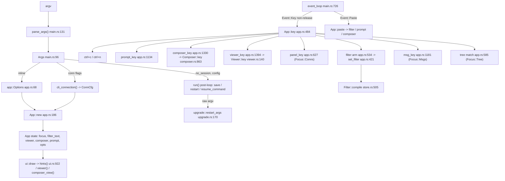

# Research: Vim-style keybindings behind a CLI flag

## Research Question

1. Q1: How does `App::key` dispatch input, and how do printable characters reach the filter?
2. Q2: What input contexts exist, and what keys does each bind today?
3. Q3: How do CLI flags flow from `parse_args` into the running app?
4. Q4: How are the bottom-bar key hints built, and how do they relate to the real bindings?
5. Q5: How is key handling tested?
6. Q6: What does "vim-like" mean in Ranger and comparable TUIs?

## Research Methodology

This document stays objective and factual. It contains no recommendations or implementation suggestions.
Open questions do not ask why something hasn't been built or what should be built in the future.

There is no "implementation" section. That is intentional.

## Summary

All keyboard input goes through one function, `App::key` (`src/app.rs:484-622`).
- It checks fixed overrides in a set order: ctrl+c, ctrl+n, the password prompt, the composer, `e`, and then the viewer.
- After those, every unmodified `KeyCode::Char` in the three main panes (connections, tree, messages) is appended to the live topic filter (`src/app.rs:534-539`). This happens before the tree or message handlers see the key.
- As a result, **no plain letter is bound in the tree, messages or connections panes today**. The one exception is `space` in the connections panel.

The full-screen viewer and the composer behave differently:
- The viewer already takes stateless single-key vim-ish letters (`j k g G b f h l q m`, `src/viewer.rs:144-171`).
- The composer is a plain text editor with emacs-style alt/ctrl chords.

Nowhere in the codebase are there multi-key sequences or a pending-prefix state.

How flags reach the app:
- CLI flags are hand-parsed into `Args` (`src/main.rs:96-122`, `:131-229`).
- They reach `App` only through the one-field `app::Options` struct (`src/app.rs:68-70`, built at `src/main.rs:599`).
- On unix, a ctrl+n restart forwards the original argv almost unchanged (`src/upgrade.rs:170-187`).
- The connections file accepts no global keys.

The bottom-bar hints are hand-written per-focus tuple lists in `src/ui.rs:922-961`. They are not derived from the bindings, and only substring tests on rendered frames cover them.

## Question Coverage

| Question | Answered in |
|---|---|
| Q1: `App::key` dispatch and the filter | §1, §2 |
| Q2: Per-context key inventory | §2, §3, §4 |
| Q3: CLI flag plumbing and restart | §5, §6 |
| Q4: Hints and other key-naming text | §7 |
| Q5: Key-handling tests | §8 (plus the **Tests:** line in each section) |
| Q6: Vim conventions in other TUIs (external) | §9 |

## Findings

### 1. `App::key` is a fixed-priority cascade where modal surfaces take the key before the panes do

The event loop sends every non-release key event to `App::key` (`src/main.rs:726`, filtered on `k.kind != KeyEventKind::Release`, so Press and Repeat both pass). Bracketed paste goes separately to `App::paste` (`src/main.rs:727`). `App::key` then runs this cascade:

```
App::key(k)                                       src/app.rs:484
├─ ctrl+c            → quit = true                 :486-489
├─ ctrl+n            → restart (if upgrade ready) or notify   :490-500
├─ prompt open?      → prompt_key(k)  (password / passphrase popup)   :501-504
├─ composer open?    → composer_key(k)             :505-508
├─ 'e' with ctrl, or plain/shift 'e' while viewer open → open_composer()   :509-514
├─ viewer open?      → viewer_key(k)               :515-518
├─ Tab / BackTab     → next_focus (all three panes)   :519-523
├─ focus == Conns    → panel_key(k); return if it consumed the key   :524-526
├─ ctrl+t / ctrl+y   → copy topic / message (not in Conns)   :527-533
├─ filter editing (all panes)                      :534-565
│   ├─ Char(c) without ctrl/alt → filter_text += c
│   ├─ Backspace                → pop a char
│   ├─ ctrl+w                   → delete back to the previous '/' level
│   ├─ ctrl+u                   → clear filter
│   └─ ctrl+r (not Conns)       → capture_selected()
├─ focus == Msgs     → msg_key(k)                  :567-570
└─ tree pane navigation (needs a selected node)    :572-621
```

Because the cascade is ordered, ctrl+c and ctrl+n work everywhere, including inside the composer and viewer. A modal surface (prompt, composer, viewer) also stops every later check from running.

`Tab`/`BackTab` are handled before the per-pane branches, so they cycle focus from any of the three panes. The cycle order is connections → tree → messages, and messages is included only when the selected topic has messages (`src/app.rs:461-482`).

**Tests:** exercised only through `src/ui.rs` integration-style tests (§8). `src/app.rs` has no `#[cfg(test)]` module.

### 2. Printable characters are claimed by the filter before any pane handler runs

The filter arm at `src/app.rs:535-539` matches any `KeyCode::Char(c)` without CONTROL or ALT. Shift only arrives as an uppercase char and still matches. The arm sits *above* the `Focus::Msgs` dispatch (`:567`) and the tree `match` (`:585`). So in the tree and messages panes, every printable letter, digit, symbol and `space` extends the filter.

In the connections pane, `panel_key` runs first and consumes only `↑ ↓ Home End space Enter Esc` (`src/app.rs:627-644`). Other characters return `false` and fall through to the filter.

`set_filter` (`src/app.rs:421-448`) has a side effect that matters here: whenever the text actually changes, it **forces `self.focus = Focus::Tree`** (`:429`). So typing a letter while the messages or connections pane has focus moves focus back to the tree.

Clearing the filter re-expands the ancestors of the selected node (`:430-445`).

How each filter-editing key behaves, by pane:

| Key | Tree | Messages | Connections |
|---|---|---|---|
| printable char | append to filter | append to filter (focus → tree) | append to filter (focus → tree), except `space` |
| `Backspace` | pop char | pop char | pop char |
| `ctrl+w` | cut back to previous `/` level | same | same |
| `ctrl+u` | clear filter | same | same |
| `Esc` | clear filter (`:586`, or `:573-575` with no selection) | **back to tree, filter kept** (`:1193-1197`) | focus → tree (`:640`) |
| paste | appended trimmed to filter (`:450-460`) | same | same |

The filter text has syntax:
- `Filter::compile` switches to **Pattern** mode when the text contains `/`, `+` or `#`. Pattern mode does MQTT-style matching with a prefix match on the last level. Any other text uses **Search** mode, a case-insensitive substring match (`src/store.rs:505-522`).
- So `/` is a meaningful filter character today, and the README documents it (`README.md:117-128`).

Plain letters bound in the main panes today: **none in the tree or messages panes, and only `space` in connections**. Every other in-pane binding is an arrow, Home/End, PgUp/PgDn, Enter or Esc, or a ctrl-chord.

**Tests:** `filter_and_navigate` (`src/ui.rs:1380`) types a filter with `typ()` and then navigates. There is no dedicated test for `ctrl+w`/`ctrl+u` on the filter, or for focus jumping back to the tree on type. That last point is not verified beyond the agent's survey of test names.

### 3. The three main panes bind only non-letter navigation keys

| Context | Key | Effect | Source |
|---|---|---|---|
| Tree | `↑` `↓` | move 1 | `src/app.rs:587-588` |
| Tree | `PgUp` `PgDn` | move by tree height | `:589-590` |
| Tree | `Home` `End` | first / last row | `:591-592` |
| Tree | `→` | expand; else enter messages if it has any; else move down when already expanded | `:593-601` |
| Tree | `←` | collapse; else jump to parent row | `:602-610` |
| Tree | `Enter` | open latest message in viewer; else toggle expand | `:611-617` |
| Tree | `Esc` | clear filter | `:586` |
| Messages | `↑` `↓` | previous / next message (list is newest first) | `:1189-1190` |
| Messages | `Home` **`PgUp`** | jump to first (newest) | `:1191` |
| Messages | `End` **`PgDn`** | jump to last (oldest) | `:1192` |
| Messages | `←` `Esc` | back to tree | `:1193-1197` |
| Messages | `Enter` | open selected message in viewer | `:1198-1201` |
| Connections | `↑` `↓` `Home` `End` | move panel cursor | `:630-633` |
| Connections | `space` `Enter` | toggle connection / subscription / capture rule | `:634-639` |
| Connections | `Esc` | focus → tree | `:640` |
| Tree, Messages | `ctrl+t` / `ctrl+y` | copy topic / message | `:527-533` |
| Tree, Messages | `ctrl+r` | capture subtree on/off | `:560-563` |
| all three | `ctrl+e` | open composer | `:511-514` |
| all three | `ctrl+w` `ctrl+u` `Backspace` | filter editing (§2) | `:540-559` |
| anywhere | `ctrl+c` / `ctrl+n` | quit / restart into newer binary | `:486-500` |

In the messages pane, PgUp/PgDn are aliases for Home/End rather than paging, because the list holds at most `--history` messages, 10 by default.

No pane has a quit key other than `ctrl+c`, and `q` is a filter character.

The password/passphrase prompt (`prompt_key`, `src/app.rs:1134-1165`) is pure text entry. Every `Char` is appended, `Backspace` pops, `Enter` submits and `Esc` cancels and moves to the next queued prompt.

**Tests:** `src/ui.rs` tests drive these with `press(&[KeyCode::…])`. Examples are `filter_and_navigate` (`src/ui.rs:1380`), `connections_panel` (`src/ui.rs:2331`), `capture_from_the_tree_and_the_panel` (`src/ui.rs:1962`) and `copy_topic_and_message` (`src/ui.rs:1841`).

### 4. The viewer already speaks single-key vim; the composer is a plain editor with emacs chords

**Viewer:**
- `App::viewer_key` (`src/app.rs:1394-1405`) takes `t`/`y` (copy) first.
- It then calls `Viewer::key(k, body_h, th) -> bool`, where `true` closes the viewer (`src/viewer.rs:140-181`).
- `Viewer::key` matches only `k.code`, except for the SHIFT check on ←/→. Ctrl/alt variants of its letters therefore also fire. For example, `ctrl+q` closes.

| Key(s) | Viewer effect |
|---|---|
| `Esc` `Enter` `q` | close |
| `↑`/`k`, `↓`/`j` | scroll 1 |
| `PgUp`/`b`, `PgDn`/`space`/`f` | scroll a page (`body_h - 1`) |
| `Home`/`g`, `End`/`G` | top / bottom (single `g`, no `gg`) |
| `shift+←`/`<`, `shift+→`/`>` | pan wide tables 8 columns |
| `←`/`h`, `→`/`l` | **older / newer message**, not horizontal scroll (`:156-163`) |
| `Tab`/`m` | cycle Pretty → Raw → Hex |
| `e` (intercepted in `App::key:511`) | open composer |
| `t` / `y` | copy topic / what the view shows |

**Composer:**
- `Composer::key(&mut self, k, page) -> Action` (`src/composer.rs:863-916`) returns `Action::{None, Send, Close}` (`src/composer.rs:676-681`).
- `App::composer_key` (`src/app.rs:1330-1342`) acts on the returned `Action` and refits the view. It adds no keys of its own.
- The composer is one free-text `Editor` over a "header: value" document. There are no fields, pickers or sub-modes.

| Key | Composer effect |
|---|---|
| `Esc` | when dirty and not yet armed: set `discard` and show "esc again discards your changes"; otherwise `Close` (`:871-872`) |
| `ctrl+s` | `Send` (`:873`) |
| `ctrl+f` | toggle JSON pretty/compact (`:874`, `:919-942`) |
| `alt+b` / `alt+f`, `ctrl/alt+←→` | word left / right (`:875-876`, `:898-899`) |
| `Char(c)` where `ctrl == alt` | insert (plain, shift, or AltGr) (`:877-881`) |
| `Enter` `Tab` `Backspace` `Delete` | newline keeping indent / two spaces / delete (`:882-897`) |
| arrows, `PgUp/PgDn`, `Home/End`, `ctrl+Home/End` | cursor movement (`:900-912`) |

The `discard` flag is the only two-step key behaviour anywhere. It is a boolean that is cleared on any non-Esc key (`:866-868`), not a general chord mechanism.

A grep for `pending`, `prefix`, `chord` and `last_key` found no key-sequence state in `src/`. So `gg` or `dd` style sequences have no existing infrastructure.

**Tests:**
- Composer: unit tests in `src/composer.rs:985+` use the helper `key(&mut Composer, KeyCode, KeyModifiers) -> Action` (`:1004`) and `typ` (`:1008`). Examples are `keys_edit_and_esc_twice_discards` (`:1232`) and `json_pretty_and_compact` (`:1256`).
- Viewer: **`src/viewer.rs` has no tests.** Its keys are covered only indirectly through `src/ui.rs` (`filter_and_navigate` asserts that `>` pans, at `src/ui.rs:1444-1445`).

### 5. CLI flags are hand-parsed into `Args`; only `app::Options` carries UI settings into `App`

**Parsing:**
- `parse_args() -> Result<Option<Args>, String>` (`src/main.rs:131`) fills `Args` (`:96-122`) with defaults and env overrides (`:133-158`).
- It then runs one `while let` over `std::env::args().skip(1)` with a `match name.as_str()` (`:161-229`).
- The parser splits `--x=v` forms. A `val()` closure takes the inline value or the next argument.
- An unknown `-…` argument is an error that appends `USAGE` (`:226`). A bare argument becomes the broker.

**`USAGE` text:**
- `USAGE` (`src/main.rs:47-93`) groups flags under "Connection flags" and "Sessions and files". It has no group for UI or display options.
- `--inline` and `--history` sit under "Connection flags".
- Env-var precedent for booleans: `FSS_MQTT_SESSION=off` sets `no_session` (`:157`).

Where each flag ends up:

| Flag | `Args` field | Parsed | Destination |
|---|---|---|---|
| `--inline N` | `inline: usize` | `:204` | `app::Options { inline_bytes }` (`main.rs:599`) → `App.opts` (`src/app.rs:135`), read in `src/ui.rs:493-496` |
| `--no-save` (bool) | `no_save` | `:185` | `ConnCtl.saved` only (`main.rs:376-385`); `App` never sees it |
| `--insecure` (bool) | `insecure` | `:205` | merged into `ConnCfg.insecure` (`main.rs:285`) |
| `--resume` (bool) | `resume` | `:217` | `session::load` → `app.restore_view` (`main.rs:601-603`) |
| `--no-session` (bool) | `no_session` | `:218` | post-loop save decision in `run` (`main.rs:621`, `:642`) |
| `-q/--qos N` | `qos: u8` | `:194-201` | `ConnCfg.qos` via `cli_connection` (`main.rs:286-288`) |

Note: `-q` is `--qos`, not a "quiet" boolean.

`App::new(store, opts: Options, th: Theme, ctls, config_path, ask) -> App` (`src/app.rs:186-193`) stores `opts` and `th` directly. `app::Options` (`src/app.rs:68-70`) has exactly one field, `inline_bytes`. It is the only struct that carries a global UI option from the command line into `App`.

`App.upgrade` and `App.restart` are public fields set after construction (`main.rs:604`).

`event_loop` receives only `&mut App` and never sees `Args`.

**Tests:**
- `parse_args` and `cli_connection` have **no tests**. `parse_args` reads `std::env::args()` directly, so it cannot be called with a custom argv.
- `src/main.rs:743-777` tests only pure helpers: `shell_quote`, `parse_size` and `absolute_path`.

### 6. A ctrl+n restart re-execs with the original argv on unix, but Windows prints a reconstructed command that keeps only `--config`

The restart path runs in this order:
1. `ctrl+n` sets `restart` and `quit` (`src/app.rs:493-494`).
2. After the loop, `run` calls `restart(&a, &app, session_path)` (`src/main.rs:618-619`, `:637-669`).
3. `restart` saves the session and then builds args with `upgrade::restart_args(&std::env::args_os().skip(1)…, resume)` (`:648`).

`restart_args` (`src/upgrade.rs:170-187`) works on the **raw original argv**:
- It drops `--resume`, `--open <path>` and `--open=…`.
- It forwards every other element unchanged.
- It appends `--resume` when the session was saved.

A flag passed on the original command line therefore survives an in-place restart on unix (`exec`, `main.rs:650-658`).

On non-unix, which includes Windows, there is no exec:
- `restart` prints `Continue session: {resume_command(a)}` (`main.rs:660-667`).
- `resume_command` (`main.rs:689-702`) **rebuilds** the command from `Args` as `<prog> --resume [--config X]`, keeping no other flag.
- The same `resume_command` text is printed after an ordinary quit that saved a session (`main.rs:628`).

Persistent per-user state outside the CLI:

| Store | Location | Holds | Global prefs? |
|---|---|---|---|
| Connections file | `config::default_path()` (`src/config.rs:44-55`): `%APPDATA%\fss-mqtt\connections.toml` / XDG config | `[[connection]]` blocks only | **No.** `parse_blocks` rejects any other `[section]` and any key before the first `[[connection]]` (`src/config.rs:243-248`). `set()` (`:385-436`) accepts only per-connection keys. |
| Session | `session::default_path()` (`src/session.rs:28-38`): `%LOCALAPPDATA%` / XDG state | messages, connections, `View` (filter, expanded, selection, `focus: String` at `src/session.rs:48`, unsent publish doc) | Partly: `View` restores UI state with `--resume`, but holds no keymap or option |
| Theme | env (`COLORFGBG`, depth vars), `Theme::detect()` (`src/theme.rs:99`) | colours | not persisted |

**Tests:**
- `restart_keeps_the_arguments_and_continues` (`src/upgrade.rs:194`) feeds a mixed argv to `restart_args` and asserts what is dropped and appended.
- Config has `upsert_*` tests on a `SAMPLE` const (`src/config.rs:445`, `:500`, `:516`).
- Session round-trips are tested in `src/session.rs:489-626`.

### 7. Bottom-bar hints are hand-written per-focus tuple lists, independent of the bindings

**Format and truncation:**
- `hint(th, pairs: &[(&str, &str, u8)], width)` (`src/ui.rs:865-895`) renders `key desc` pairs joined by ` · `.
- While the line is too wide, it drops the remaining pair with the highest rank above 0. Ties drop the rightmost first, and rank 0 is never dropped.

**Where each hint list comes from:**
- `hints(app)` (`src/ui.rs:922-961`) picks a literal `vec!` by `app.focus`.
- It then appends `^n restart` (rank 0, only while an upgrade is offered) and `^c quit` (rank 0).
- An active notice replaces the hint line entirely (`notice_line`, `:914`).
- The viewer and composer build their own lists inside `viewer()` (`src/ui.rs:981-990`) and `composer_view()` (`:1039-1043`).
- The password prompt has a fixed line (`:293-296`).

| Context | Hints, with rank (lower survives longer; 0 = always) |
|---|---|
| Conns | `↑↓ move`(3) · `space ⏎ connect / on-off`(1) · `tab pane`(2) · `type filter`(2) |
| Msgs | `↑↓ messages`(3) · `⏎ open`(2) · `^e publish`(1) · `^t ^y copy`(1) · `^r capture`(1) · `← esc back`(2) · `tab pane`(2) |
| Tree | `↑↓ move`(3) · `←→ collapse/expand`(3) · `⏎ open`(2) · `^e publish`(1) · `^t ^y copy`(1) · `^r capture`(1) · `esc clear filter`(2) · `tab pane`(2) |
| Viewer | `↑↓ pgup pgdn scroll`(3) · `←→ older/newer`(2) · [`shift ←→ pan`(1) when wide] · `tab view: mode`(1) · `e publish`(1) · `t y copy`(1) · `esc back`(0) |
| Composer | `^s send`(0) · `esc cancel`(0) · `^f JSON pretty/compact`(1) |
| Prompt | fixed: `⏎ connect · esc cancel · kept in memory only` |

The hints are a curated subset. They omit the viewer's letter aliases (`j k g G b f h l q m < >`), `shift+tab`, `ctrl+w`/`ctrl+u`, and anything in the tree about typing to filter. Only the Conns list carries `type filter`.

Other user-visible text that names specific keys:
- `src/ui.rs:375`: header `↑ v · ^n restart`.
- `src/ui.rs:418`: "tab to Connections, then space to connect".
- `src/ui.rs:666`: "⏎ to view all".
- `src/ui.rs:724`: "^e sends one to a broker".
- `src/app.rs:319-321`: "ctrl+n restarts into it…".
- `src/composer.rs:818`: "esc again discards your changes".
- `USAGE` mentions ctrl+r, ctrl+n and ctrl+e (`src/main.rs:66`, `:83`, `:86`, `:90`).
- A ctrl+r reminder at `src/main.rs:406`.

README sections that document keys:
- `README.md:117-128`: Filtering, including `backspace`, `ctrl+w`, `esc`/`ctrl+u`.
- `:130-155`: the Keys table.
- `:164-176`: Clipboard.
- `:178-209`: Publishing; line 208 covers `ctrl+s`, `esc` twice and `ctrl+f`.
- `:268-275`: Capture, `ctrl+r`/`space`.
- `:319`: `ctrl+e` on a file connection.
- `:351-355`: in-place upgrade and `ctrl+n`.

**Tests:** hint text is checked only by substring asserts on rendered frames:
- `"shift ←→ pan"` (`src/ui.rs:1438`)
- `"^e publish"` (`:1704`)
- `"^s send"` (`:1719`)
- `"esc again discards your changes"` (`:1755`)
- `"^n restart · ^c quit"` (`:2311`)

No test checks the hints against the real bindings, and no test asserts rank-based truncation. `resize(60,30)` at `:1451-1452` renders without asserting.

### 8. Key tests drive a real `App` through `app.key()` and assert on rendered `TestBackend` text plus public state

The `src/ui.rs` test module (`:1093+`) is the de facto key-handling suite.

**Fixture:**
- `sample(config_path)` (`src/ui.rs:1119`) and `sample_store()` (`:1125`) build a real `Store` with a connected "local" connection that has preloaded messages, and a "staging" connection that needs a password and a passphrase.
- `app_with` (`~:1160-1253`) creates one `ConnCtl` per connection with an mpsc `tx`. The receivers act as a fake broker: tests `try_recv()` a `Cmd::Publish`.
- It calls `App::new(…, Options { inline_bytes: 64 }, Theme::new(false), …)` (`:1241`), then `resize(110, 36)` and `tick()`.

**Input helpers:** each one calls `app.key(KeyEvent::new(…))` directly.
- `typ(app, &str)` (`:1255-1259`)
- `press(app, &[KeyCode])` (`:1260-1263`)
- `ctrl(app, char)` (`:1694-1696`)

**Rendering:**
- `frame(app, label) -> String` (`:1266-1281`) draws onto `Terminal::new(TestBackend::new(w, h))` and returns the buffer as trimmed text rows.
- `html()` (`:1284`) is used only by the ignored `snapshots` test (`:1338`).

**Assertions** combine `frame(..).contains(..)` with direct field checks: `app.focus`, `app.viewer`, `app.composer`, `app.notice`, `app.quit` and `app.restart`.

Representative tests:
- `filter_and_navigate` (`:1380`)
- `focus_helpers_and_thread_notices` (`:1671`)
- `compose_and_publish` (`:1699`)
- `copy_topic_and_message` (`:1841`)
- `a_session_comes_back_as_it_was` (`:2210`)
- `ctrl_n_restarts_into_a_newer_version` (`:2297`)
- `connections_panel` (`:2331`)

Every test builds `Options` inline, so a field added there would appear at `src/ui.rs:1241`. That is the one construction site in tests.

**Tests:** n/a. This section *is* the test inventory. The gaps are summarised in §5, §4 and §7: no `parse_args` tests, no viewer unit tests, no hint/binding consistency test.

### 9. External: vim-style TUIs mostly ship vim keys as defaults; the opt-in precedent is a keymap file, not a flag

These findings are **external** (web sources, not `file:line`):

| Tool | Vim keys | How enabled | Filter / search | Source |
|---|---|---|---|---|
| ranger | `hjkl`, `gg`/`G`, `J`/`K` and `ctrl+d`/`ctrl+u` half page, `ctrl+f`/`ctrl+b` page | default (arrows `copymap`'d to hjkl) | `/` search, `n`/`N`; `zf` filter; `f` find; `q` quit; `Esc` closes console | [rc.conf](https://raw.githubusercontent.com/ranger/ranger/master/ranger/config/rc.conf) |
| yazi (Rust) | `hjkl`, `gg`/`G`, `ctrl+d/u` half, `ctrl+f/b` full | default; user `keymap.toml` overrides | `/` find, `n`/`N`; `f` filter; input: `Esc` cancel, `Enter` submit; `?` is find-previous, help is `~`/F1 | [keymap-default.toml](https://raw.githubusercontent.com/sxyazi/yazi/main/yazi-config/preset/keymap-default.toml) |
| gitui (Rust, ratatui) | `hjkl`, `g`/`G`, `ctrl+b/f` | **opt-in**: copy `vim_style_key_config.ron` into `key_bindings.ron` (`%APPDATA%/gitui` or `~/.config/gitui`); no CLI flag found | filter/search keys keep defaults | [KEY_CONFIG.md](https://github.com/gitui-org/gitui/blob/master/KEY_CONFIG.md), [vim_style_key_config.ron](https://raw.githubusercontent.com/gitui-org/gitui/master/vim_style_key_config.ron) |
| bottom (btm) | `hjkl`, `gg`/`G`, `ctrl+u/d` half page, `?` help, `q` quit | default | `/` or `ctrl+f` opens search; typed letters go to the query (`alt+h/l` move the cursor); `Esc` closes and **keeps** the filter | [general-usage](https://raw.githubusercontent.com/ClementTsang/bottom/main/docs/content/usage/general-usage.md), [process widget](https://raw.githubusercontent.com/ClementTsang/bottom/main/docs/content/usage/widgets/process.md) |
| lazygit | `j`/`k`, `ctrl+u/d` scroll main, `?` keybindings menu, `:` shell, `q` quit | default; remappable in `config.yml` (not verified) | `/` filters/searches current panel | [Keybindings_en.md](https://raw.githubusercontent.com/jesseduffield/lazygit/master/docs/keybindings/Keybindings_en.md) |
| htop | not vim by default | n/a | `/` incremental search, `\` incremental filter, `Esc` clears | [htop(1)](https://man7.org/linux/man-pages/man1/htop.1.html) |

Conventions across these tools:
- **`ctrl+d`/`ctrl+u`** mean half-page scroll in navigation context. The readline "kill line" meaning of `ctrl+u` applies only inside a focused text input.
- **`q`** quits and **`Esc`** cancels or goes back.
- **`/` enters a query-input mode** where letters stop navigating.
- **What happens when you leave filter mode varies:**
  - `Enter` accepts and keeps the filter (yazi, ranger).
  - `Esc` keeps it in bottom but clears it in htop.
- `gg` is a two-key sequence in ranger, yazi and bottom. gitui uses a single `g`.

Gaps in the external search:
- k9s, tig, nnn/lf and aerc docs were not fetched.
- No ratatui app with a dedicated `--vim` CLI flag was found. This is a negative result, held with moderate confidence.
- How ranger displays a pending key prefix comes from the agent's memory and is unverified.

**Tests:** n/a (external).

## Architecture

The input path from crossterm through the dispatch cascade, and where flag values reach it today:



The patterns in this map:
- **Bindings are inline `match` arms** in five handlers spread across three files. There is no keymap table, action enum (except the composer's three-variant `Action`) or binding registry.
- **Modal precedence is implicit** in the order of the `if self.x.is_some()` checks in `App::key`.
- **Hints are a parallel, hand-maintained description** of the bindings in `ui.rs`.
- **Global UI options travel only via `app::Options`.** The connections file and the session store carry no keymap or preference.

## Code References

### Key dispatch (exhaustive for the main panes)
- `src/main.rs:726-727`: key/paste events into `App`, release events filtered.
- `src/app.rs:484-622`: `App::key` cascade, filter arm (`:534-565`) and tree navigation (`:585-619`).
- `src/app.rs:421-448`: `set_filter`, which forces focus to the tree and re-expands on clear.
- `src/app.rs:450-460`: `App::paste`.
- `src/app.rs:461-482`: `next_focus` (tab order).
- `src/app.rs:627-644`: `panel_key`.
- `src/app.rs:1134-1165`: `prompt_key`.
- `src/app.rs:1169-1206`: `enter_msgs`, `msg_key`.
- `src/app.rs:96-101`: `Focus` enum.
- `src/store.rs:505-522`: `Filter::compile` (where `/ + #` select Pattern mode).

### Viewer and composer (exhaustive)
- `src/app.rs:1394-1405`: `viewer_key` (`t`/`y`).
- `src/viewer.rs:140-181`: `Viewer::key`.
- `src/app.rs:1301-1342`: `open_composer`, `composer_key`.
- `src/composer.rs:676-681`: `Action`. `:701`: the `discard` flag. `:863-916`: `Composer::key`. `:919-942`: `toggle_json`.

### CLI and persistence (key files)
- `src/main.rs:47-93`: `USAGE`.
- `src/main.rs:96-122`: `Args`.
- `src/main.rs:131-229`: `parse_args`.
- `src/main.rs:254-300`: `cli_connection`.
- `src/main.rs:312`, `:599-604`: `run`, `Options` and `App::new`.
- `src/main.rs:618-669`: post-loop `restart`.
- `src/main.rs:689-702`: `resume_command`.
- `src/upgrade.rs:170-187`: `restart_args`.
- `src/app.rs:68-70`: `Options`. `:133-182`: `App` fields. `:186-193`: `App::new`.
- `src/config.rs:23-41`: `ConnCfg`. `:44-55`: path. `:221-278`: `parse_blocks`. `:385-436`: `set`.
- `src/session.rs:28-48`: session path and `View`.
- `src/theme.rs:99`: `Theme::detect`.

### Hints and key-naming text (key files)
- `src/ui.rs:865-895`: `hint`. `:898-912`: `hint_room`/`with_version`. `:914`: `notice_line`. `:922-961`: `hints`.
- `src/ui.rs:964-999`: viewer hints. `:1036-1045`: composer hints. `:293-296`: prompt line.
- `src/ui.rs:375, 418, 666, 724`: `src/app.rs:319-321`, `src/composer.rs:818`. Other key-naming strings.
- `README.md:117-128, 130-155, 164-176, 178-209, 268-275, 319, 351-355`.

### Tests
- `src/ui.rs:1093+`: test module. Fixtures at `:1119-1253`; `typ`/`press` at `:1255-1263`; `frame` at `:1266-1281`; `ctrl` at `:1694`.
- `src/ui.rs:1380, 1671, 1699, 1841, 1962, 2210, 2297, 2331`: representative key-flow tests.
- `src/composer.rs:985+`: composer unit tests (`key` helper at `:1004`).
- `src/upgrade.rs:194`: `restart_args` test.
- `src/main.rs:743-777`: helper tests only.
- No tests: `src/viewer.rs`, `src/app.rs` (no module), `parse_args`.

## Discovered Unknowns

- **`/` is already a filter metacharacter.** It switches the filter to MQTT Pattern mode (`src/store.rs:508`), and filters like `v1/#` begin with typed text that contains `/`. A key that enters a filter mode by pressing `/` would interact with that syntax.
- **Typing moves focus.** `set_filter` forces `Focus::Tree` (`src/app.rs:429`), so a letter typed in the messages or connections pane leaves that pane.
- **`Esc` is overloaded differently per pane.** It clears the filter in the tree, keeps the filter and goes back in messages, and only moves focus in connections (§2 table).
- **Several existing ctrl-chords collide with vim meanings:**

  | Chord | fss-mqtt today | Vim meaning |
  |---|---|---|
  | `ctrl+u` | clear filter | half-page up |
  | `ctrl+e` | publish | scroll a line |
  | `ctrl+y` | copy message | scroll a line back |
  | `ctrl+r` | capture | redo |
  | `ctrl+f` | composer JSON toggle | page down |
  | `ctrl+n` | restart (global, checked first) | next |

  `ctrl+d` and `ctrl+b` are unbound in the main panes.
- **`h`/`l` already have a non-vim meaning in the viewer**: older/newer message, not horizontal scroll (`src/viewer.rs:156-163`). Horizontal pan is on `<`/`>`/shift+arrows.
- **The viewer ignores ctrl/alt on its letter keys** (`src/viewer.rs:143-171`), so `ctrl+j` and similar also act.
- **No `q`-to-quit and no `?` help** exist in the main panes. `ctrl+c` is the only quit.
- **On Windows a ctrl+n restart does not re-exec.** The printed `Continue session:` command and the post-quit resume hint are rebuilt from `Args` with only `--resume [--config]` (`src/main.rs:689-702`). Any other original flag is absent from that printed command. On unix the raw argv is forwarded (`src/upgrade.rs:170-187`).
- **`--resume` restores `focus` and the filter text** through the session `View` (`src/session.rs:42-48`). No keymap state is stored there.

## Open Questions

None. Every question was traced to code or (Q6) to external sources. The external gaps noted in §9 are k9s/tig/nnn docs not fetched, and ranger's pending-prefix display unverified. They concern background conventions, not this codebase.
