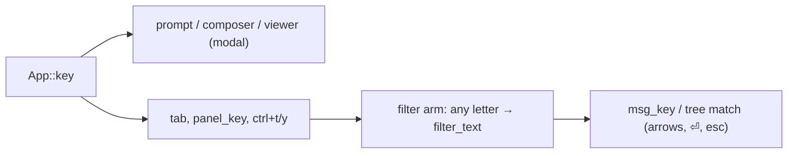
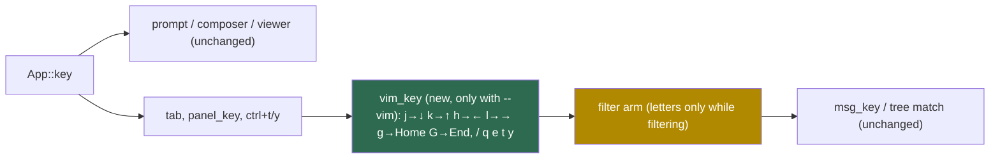

# Design: Vim-style keys behind `--vim`

## Summary of Change Request
The user wants a CLI flag that switches the TUI to vim-like keys, as in Ranger.
Recommended: `--vim` turns the main panes modal. Letters navigate, and `/` opens the filter. A small translation step maps vim keys onto the handlers that already exist, so default mode is byte-for-byte unchanged.

## Current State
- Every unmodified letter in the tree, messages and connections panes is appended to the live filter before any pane handler runs (`src/app.rs:534-539`, research §2). So no letter is free to bind today.
- The full-screen viewer already takes `j k g G b f q` (`src/viewer.rs:144-171`, §4). The composer is a plain text editor (§4).
- UI options reach `App` only through `app::Options` (`src/app.rs:68-70`, §5). Bottom-bar hints are hand-written per focus (`src/ui.rs:922-961`, §7).

## Desired End State
Example, with `fss-mqtt --vim` and the cursor on `site` in the tree:
- Today, `j` filters for "j". With `--vim`, `j` moves down, `l` expands, `G` jumps to the end, and `q` quits.
- `/` puts the cursor in the filter box. `sensor/+/temp` filters live as you type, as it does today. `⏎` keeps the filter and returns to navigation, so `j` moves again.

Success condition: without `--vim`, every existing test passes unchanged. With it, the panes navigate by letter, the hints and the filter placeholder show the vim keys, and the viewer, composer and password prompt behave as before.

## Architecture: Before → After

Before: the filter arm swallows letters ahead of the panes.

After: in vim mode, a translation step runs before the filter arm. The filter arm only takes letters while `/` input is open.

## Approach
- **Flag:** add a `vim: bool` to `app::Options` (`src/app.rs:68`), parsed in `parse_args` the same way as `--insecure` (`src/main.rs:205`) (D4).
- **Translation:** add a `vim_key` step in `App::key` after `panel_key`/copy and before the filter arm. It rewrites vim keys into the `KeyCode` the existing tree, messages and panel handlers already understand. The new behaviour is limited to `/`, `q` and the e/t/y letter aliases, which reuse `open_composer`, `copy_topic` and `copy_message` (D1, D3).
- **Filter mode:** a new `App.filtering: bool`. The filter arm's `Char` case runs only when `!vim || filtering`. Backspace, ctrl+w and paste keep working in both modes, and a paste opens filtering (D2).
- **Hints and placeholder:** `hints()` and `input_box()` (`src/ui.rs:821-961`) choose vim labels when `opts.vim` is set. In filter mode they show `⏎ keep · esc clear`. The README Keys table gets a vim column or section.
- **Tests:** follow the `src/ui.rs` pattern (`typ`/`press` + `frame` asserts, `:1255-1281`). An `app_with` variant builds `Options { vim: true }` and gets tests for navigation, `/` filter round-trip, `q`, and hint text. Existing tests stay the regression guard for default mode. `parse_args` stays untested (research §5).

## Decisions

### D1: Map vim keys onto the existing handlers with a translation shim
**Status:** Resolved
**Decision:** A `vim_key` step before the filter arm rewrites vim keys into the `KeyCode`s the tree, messages and panel handlers already handle. It is a small diff, default mode stays identical, and tested handlers are reused. The user accepted this.
**Superseded by:** structure D1 — `vim_key` runs before `panel_key` (not after it), so the connections pane gets the translated `↓`/`↑`.
**Alternatives:**
- Action enum + keymap table for all panes: it would derive hints from bindings, but it means a large `App::key` refactor and regression risk for one flag.

### D2: `⏎` keeps the filter, `esc` clears it, and both leave `/` mode
**Status:** Resolved
**Decision:** This matches yazi/ranger and today's tree `esc`, so one key undoes a filter. In navigation, `esc` still clears the filter. The user accepted this.
**Alternatives:**
- `⏎` and `esc` both keep (bottom): clearing would need an extra step, and it breaks the current `esc` meaning.

### D3: Vim mode binds `j k h l g G ctrl+d ctrl+u / q e t y`; a single `g` goes to the top
**Status:** Resolved
**Decision:**
- `j k` move, `h l` act as `← →`, `g G` go to top/bottom, `ctrl+d/u` page.
- `/` filter, `q` quit, `e` publish, `t y` copy, the same letters as the viewer.
- A single `g` needs no key-sequence state, and `gg` still works. `ctrl+u` drops "clear filter" in vim mode. Other ctrl chords are unchanged.

The user accepted this.
**Alternatives:**
- True `gg` with a pending prefix: new state and indicator for no visible gain.
- Navigation keys only, without `q e t y`: misses the most-expected vim key, `q`.

### D4: `--vim` flag, plus `FSS_MQTT_KEYS=vim`, kept in the resume command
**Status:** Resolved
**Decision:** The env var follows `FSS_MQTT_SESSION=off` (`src/main.rs:157`) and gives an always-on option without a prefs file. `resume_command` (`src/main.rs:689-702`) emits `--vim` so the printed Windows resume line keeps it. The user accepted this.
**Alternatives:**
- `--vim` only: it has to be retyped on every start and is lost from the Windows resume line.
- `[ui]` section in connections.toml: that file is connections-only by design (`src/config.rs:243-248`).

## Uncertainties
- **`ctrl+d`/`ctrl+u` page by a full page, not half.** They map to PgDn/PgUp, and in messages those jump to the ends (§3). The user accepted this: it is the existing paging behaviour.
- **A filter that starts with `/` needs `/` typed twice.** The user accepted this: such filters are rare in MQTT topics.
- **The composer has no vim mode.** It stays a plain editor. The user accepted this; it is out of scope (see below).

## What We're NOT Doing
- No user-configurable keymap file and no `?` help overlay.
- No vim normal/insert modes in the composer or the password prompt.
- No changes to the viewer's keys. They are already vim-like.
- No change to default (non-`--vim`) behaviour.

## Approval
Approved by the user on 2026-10-20. Conditions: none. All recommendations were accepted as proposed.
